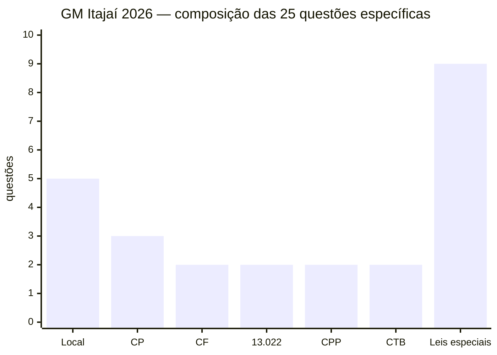
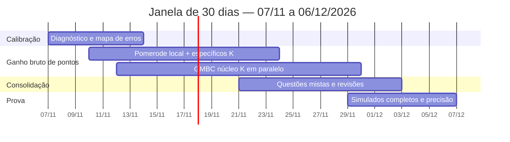
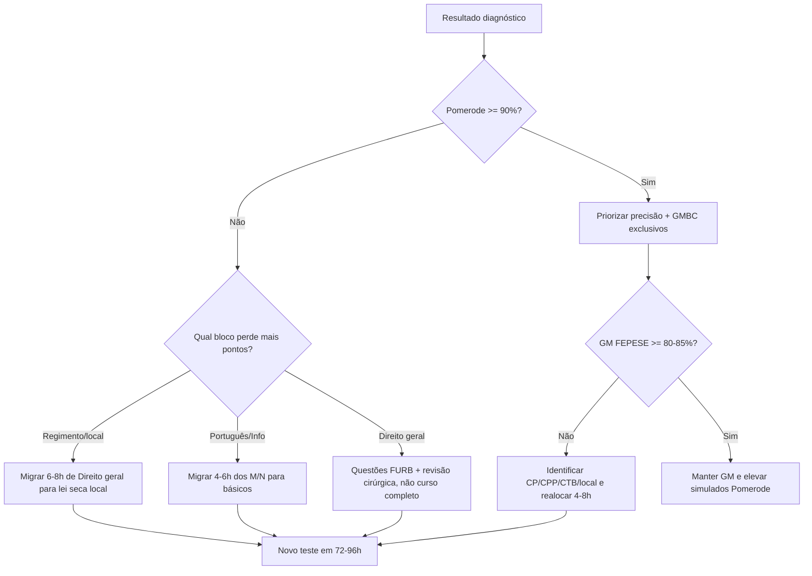

# Mentoria estatística integrada — GM Balneário Camboriú + Câmara de Pomerode

## Resumo executivo

A conclusão mais importante é esta: **nas próximas quatro semanas, eu não dividiria seu esforço em 50% Pomerode / 50% GMBC**. A Câmara de Pomerode tem prova objetiva confirmada para **13 de dezembro de 2026**, com 60 questões e peso de **50% da nota em Conhecimentos Específicos**; já o novo concurso da GMBC ainda não tem edital publicado nem banca oficialmente anunciada. Em **15 de outubro de 2026**, a Prefeitura de Balneário Camboriú informou oficialmente que a contratação da banca e a elaboração do edital estavam em andamento. A página municipal de editais, consultada agora, também não mostra ainda o novo edital da Guarda. Com suas **180 horas líquidas disponíveis nos próximos 30 dias**, meu orçamento inicial seria aproximadamente **112 horas em conteúdos com impacto predominante em Pomerode, 53 horas em conteúdos exclusivos ou predominantemente policiais da GMBC e 15 horas em simulados/análise de erros**. Isso não significa abandonar a GM: Direito Administrativo, Constitucional, Português, Lógica, licitações e parte de Informática/Administração Pública produzem transferência entre os dois certames.

Há um ponto estatístico particularmente útil na prova real da **GM Itajaí 2026**, nossa melhor referência recente: dos 25 itens de Conhecimentos Específicos, **5 questões (20%) eram legislação municipal própria**, 11 questões (44%) estavam no núcleo CF/Lei 13.022/CP/CPP/CTB e 9 questões (36%) distribuíram-se entre legislação especial e direitos humanos. Como cada específico valia 0,26 ponto, legislação local representou **1,30 ponto dos 6,50 pontos de específicos** naquela prova. Para Pomerode, o padrão estratégico é diferente. O edital oficial entrega **5,00 pontos a Conhecimentos Específicos, 1,50 a Português, 1,50 a Informática, 0,75 a Lógica, 0,75 a Legislação Municipal e 0,50 a Conhecimentos Gerais**. O conteúdo específico inclui Direito Administrativo e Constitucional, mas também processo legislativo municipal, redação oficial, técnica legislativa, gestão documental, Lei 14.133/2021, transparência e proteção de dados. Portanto, o erro mais provável para alguém com seu perfil — base jurídica avançada — seria gastar horas excessivas reaprendendo teoria geral de Direito e deixar **Regimento + processo legislativo + Informática + particularidades locais** subtreinados. Minha classificação de prioridades será:

**K = crítico**, assunto em que eu investiria horas imediatamente porque combina peso, probabilidade de incidência e/ou risco de diferenciação; **M = médio**, assunto que deve entrar no ciclo, mas não roubar horas dos K; **N = manutenção**, assunto para questões/revisões seletivas enquanto seu desempenho permanecer alto.

O núcleo K, hoje, seria: **Regimento Interno e processo legislativo de Pomerode; legislação municipal de Pomerode; Informática FURB; Português FURB; Lei 14.133 aplicada; Estatuto/estrutura atual da GMBC; Lei 13.022 + art. 144; flagrante/busca no CPP; CP — parte geral selecionada e crimes contra Administração; CTB — competências e medidas administrativas**.

## Base de dados, método e limites estatísticos

Eu localizei nos repositórios oficiais da FURB provas/cadernos e gabaritos de concursos administrativos e legislativos recentes, incluindo concursos de 2023, 2024, 2025 e 2026, como Técnico-Administrativo FURB 2023, Câmara de Bombinhas 2024, concursos administrativos de 2025, SAMAE Blumenau 2026 e o atual concurso da Câmara de Pomerode. A FURB mantém publicações de cadernos e gabaritos nesses certames. Na FEPESE, o acervo recente inclui, entre outros, Guarda Municipal de São José em 2024, Guarda Municipal de Palhoça em 2024, Policial/Guarda Municipal de Chapecó em 2025 e Guarda Municipal de Itajaí em 2026. São José, por exemplo, teve prova objetiva com **70 questões e 5.409 inscrições homologadas**; Chapecó publicou oficialmente prova e gabarito em setembro de 2025; e Itajaí publicou prova, gabaritos e resultados do exame de conhecimento em 2026. Há, porém, uma limitação importante: **não encontrei nos repositórios oficiais um dataset de percentual de acerto por questão**, e parte do acervo da FURB é entregue por um leitor/wrapper de PDF que não permite fazer, com confiabilidade, uma extração automatizada homogênea de cada item de todos os concursos dos cinco anos. Por isso, não vou fingir que tenho uma base de milhares de questões com estatísticas item a item quando ela não está disponível publicamente dessa forma. A análise abaixo separa claramente **dados observados**, **peso oficial** e **prior estatístico/modelagem**. Os cadernos e gabaritos oficiais existem; o que não está publicamente exposto é o microdado de desempenho de cada questão. Para a GM, consegui fazer uma codificação item a item da prova mais relevante: **GM Itajaí 2026**, justamente porque ela é recente, regional, organizada pela FEPESE e tem conteúdo muito próximo do que seria plausível em BC. A própria prova mostra cobrança literal/aplicada de CF, estatuto municipal, Lei 13.022, CPP, CTB, CP e legislação especial. A métrica central que estou usando é:

\[
EPI_t = P(t \mid bloco)\times Peso_{bloco}\times G_t
\]

em que **EPI** é o impacto esperado do tópico, \(P(t\mid bloco)\) é a frequência condicional observada ou modelada dentro do bloco, e \(G_t\) é o ganho marginal esperado com estudo. Como você se declara avançado em Administrativo/Constitucional, reduzo \(G_t\) nesses tópicos em relação a assuntos em que ainda não demonstrou domínio.

### Evidência empírica mais forte: específicos da GM Itajaí 2026

| Tópico observado | Questões / 25 específicos | P(tópico \| específicos) | Pontos observados no modelo | Prioridade para BC |
|---|---:|---:|---:|---|
| Lei local/estrutura da Guarda | 3 | **12%** | **0,78** | **K** |
| Estatuto municipal dos servidores | 2 | **8%** | **0,52** | **K** |
| Código Penal | 3 | **12%** | **0,78** | **K** |
| Constituição Federal | 2 | **8%** | **0,52** | **K/M** |
| Lei 13.022/2014 | 2 | **8%** | **0,52** | **K** |
| CPP | 2 | **8%** | **0,52** | **K** |
| CTB | 2 | **8%** | **0,52** | **K** |
| SUSP | 1 | 4% | 0,26 | M |
| Lei de Drogas | 1 | 4% | 0,26 | M |
| Estatuto do Desarmamento | 1 | 4% | 0,26 | M |
| Abuso de Autoridade | 1 | 4% | 0,26 | M |
| Crimes Ambientais | 1 | 4% | 0,26 | M |
| ECA | 1 | 4% | 0,26 | M |
| Estatuto da Pessoa Idosa | 1 | 4% | 0,26 | M |
| DUDH | 1 | 4% | 0,26 | M |
| Maria da Penha | 1 | 4% | 0,26 | M |

Essa distribuição vem da prova aplicada pela FEPESE em 2026; não é uma promessa de distribuição da futura GMBC. Na prova real, por exemplo, apareceram questões sobre organização constitucional da segurança pública, provimento/exercício no estatuto municipal, Lei 13.022, prisão em flagrante, competências municipais no CTB e retroatividade/causalidade/crimes contra a Administração no Código Penal. Visualmente, o bloco específico de Itajaí ficou assim:

“Local” agrega Lei da Guarda + Estatuto dos Servidores; “leis especiais” agrega SUSP, Drogas, Desarmamento, Abuso, Ambiental, ECA, Pessoa Idosa, DUDH e Maria da Penha. ## O que as duas provas realmente premiam

### Câmara de Pomerode

Pomerode é, matematicamente, uma prova em que **erros fora dos específicos custam muito mais do que parecem**. Português e Informática somam 3,00 pontos — 30% da nota — enquanto os 25 específicos somam 5,00. Um candidato que faça 90% dos específicos, mas perca cinco ou seis questões em Português/Informática, pode entregar a primeira colocação para alguém juridicamente menos profundo, porém mais uniforme. A prova tem uma única vaga para Assistente Legislativo. O programa mostra quatro subnúcleos de alto valor dentro dos específicos: **Direito Administrativo/Constitucional**, **processo legislativo e organização da Câmara**, **Administração Pública/redação oficial/gestão documental** e **licitações/transparência/dados**. O programa cita expressamente proposições, tramitação, sessões, comissões, discussão, votação, sanção, veto, promulgação, publicação, atos do Poder Legislativo, prazos regimentais, atas, relatórios e Lei 14.133/2021. Como não temos uma prova anterior do mesmo cargo com o mesmo programa, o EPI abaixo é **intervalar**, não uma falsa frequência histórica:

| Pomerode — núcleo | Peso disponível ou EPI modelado | Prioridade | O que estudar de forma granular |
|---|---:|---|---|
| Específicos: processo legislativo + Regimento | **~1,0–1,4 pt modelado** | **K** | espécies de proposições; iniciativa; tramitação; comissões; pareceres; sessões; discussão; votação; quóruns; sanção; veto; promulgação; publicação; prazos |
| Específicos: Administrativo + Lei 14.133 | **~1,0–1,4 pt modelado** | **K/M** | atos; poderes; organização; servidores; controle; serviços; contratos; contratação direta; planejamento; pesquisa de preços; acompanhamento contratual |
| Específicos: Constitucional + Município/Poder Legislativo | **~0,8–1,2 pt modelado** | **M**, dado seu nível | competências; separação de poderes; Legislativo municipal; vereadores; imunidades; controle parlamentar; processo legislativo |
| Administração Pública + redação/gestão documental | **~0,6–1,0 pt modelado** | **K/M** | redação oficial; LC 95; protocolo; tramitação; arquivamento; digitalização; classificação documental; atas; relatórios |
| Legislação municipal | **0,75 pt oficial** | **K** | LC 269/2014; Res. 42/2013; LC 441/2021; Lei Orgânica; Res. 87/2025 |
| Português | **1,50 pt oficial** | **K** | interpretação; coesão; sintaxe; concordância; regência; crase; pontuação; semântica |
| Informática | **1,50 pt oficial** | **K** | documentos; planilhas; fórmulas/funções; filtros/gráficos; e-mail; navegador; nuvem; PDF; segurança; sistemas de protocolo |
| Lógica | **0,75 pt oficial** | M | porcentagem; proporcionalidade; probabilidade; contagem; lógica proposicional; equivalências; De Morgan; problemas |
| Gerais | **0,50 pt oficial** | N/M | Pomerode/SC + atualidades direcionadas |

Os conteúdos acima constam expressamente do Anexo II. A Resolução Legislativa **87/2025** é o atual Regimento Interno cobrado pelo edital, e a prova está marcada para 13/12/2026. ### GMBC

O melhor prior atual é Itajaí, mas há um ajuste indispensável: **trocar a legislação local de Itajaí pela estrutura vigente de BC**. A Lei 3.029/2009 foi substancialmente modificada, inclusive pela LC 104/2024, que reorganizou a GM, criou/disciplinou estruturas como CEFAG, Núcleo de Inteligência e ROMU e substituiu o Estatuto da Guarda no Anexo C; em outubro de 2026 o Município também ampliou o quadro autorizado de 200 para 290 cargos. Na FEPESE 2026, o desenho de Itajaí destinou **6,50 dos 10 pontos da objetiva aos específicos**, com cinco questões para cada um dos blocos de Português, História/Geografia local, Lógica, TIC e Administração Pública. O conteúdo específico oficial incluiu CF/88, Lei 13.022, lei local da Guarda, estatuto dos servidores, SUSP, CTB, Desarmamento, CP, CPP, Drogas, Crimes Ambientais e Abuso de Autoridade, além das demais leis protetivas. Eu trabalharia com três cenários, sem atribuir falsa probabilidade objetiva enquanto BC não publica o edital:

| Cenário GMBC | Hipótese de prova | Efeito estratégico |
|---|---|---|
| **Mais provável para planejamento** | Estrutura semelhante a Itajaí: específicos ~60–65%; legislação local dentro do bloco | Mantém K em lei local + 13.022 + CP/CPP/CTB |
| **Pior para integração** | BC aumenta legislação local/história municipal e reduz conteúdo federal | Exige migrar 8–12h de CP/leis especiais para lei local imediatamente |
| **Melhor para integração** | Maior peso em Administração, CF, Português, Lógica, TIC e legislação federal | Seu estudo de Pomerode transfere mais; necessidade de horas exclusivas da GM cai |

Não há base séria hoje para dizer “70% de chance” para um desses formatos. O fato oficial é apenas que o novo concurso está em elaboração; o formato de Itajaí é um **prior operacional**, não uma previsão do edital. ## Sobreposição e valor de transferência

O maior ganho da preparação paralela vem de **não estudar duas vezes aquilo que é conceitualmente igual**.

Criei um índice de transferência entre 0 e 1. Ele não é uma frequência histórica; é uma medida semântica de quanto uma hora bem feita em determinado assunto pode ser reutilizada no outro edital/modelo.

| Assunto | Pomerode | GM-Itajaí/BC | Índice de transferência | Estratégia |
|---|---:|---:|---:|---|
| Administração Pública / art. 37 | forte | forte | **0,90** | estudar uma vez, questões das duas bancas |
| Lei 14.133 / contratos | forte | presente em Administração | **0,90** | núcleo comum |
| Português | 1,50 pt | 0,70 pt no prior | **0,80** | teoria comum, treino separado por banca |
| Lógica | 0,75 pt | 0,70 pt | **0,85** | forte reaproveitamento |
| Constitucional: direitos/art. 37 | específico | específico | **0,75** | manutenção por questões |
| Informática/TIC | 1,50 pt | 0,70 pt | **0,45** | só parcialmente comum |
| LAI/LGPD/transparência | específico/Informática | TIC/Admin | **0,70** | ótimo tópico de intersecção |
| Legislação municipal Pomerode | 0,75 + reflexo em específicos | — | **0** | exclusiva |
| Processo legislativo | alto | — | **0** | exclusiva |
| Lei/Estatuto GMBC | — | alto | **0** | exclusiva |
| CP/CPP/CTB | — | alto | **0** | exclusiva |

O conteúdo oficial de Pomerode inclui Lei 14.133, transparência e proteção de dados; Itajaí colocou Lei 14.133, LAI e temas de governo digital/TIC no programa geral, além de CF e Administração no específico. Usando os pesos de Itajaí como prior, aproximadamente **2,5 a 3,0 pontos de uma objetiva de 10** podem receber benefício relevante de preparação compartilhada — sobretudo Português, Lógica, Administração/licitações, constitucional e parte de TIC. Isso é uma estimativa de transferência, não uma previsão de questões.

O ponto estratégico é que **o estudo comum deve ser puxado pelo formato de Pomerode até 13/12**, porque é a prova com prazo confirmado. Depois da prova, praticamente todo esse orçamento de horas pode migrar para os exclusivos da GM.

## Lista priorizada e orçamento das próximas 180 horas

Este é um **orçamento de atenção**, não um calendário rígido. Depois do primeiro diagnóstico, eu moveria horas entre blocos.

| Prioridade | Bloco específico | Horas / 30 dias | Resultado esperado |
|---|---|---:|---|
| **K** | Pomerode — Regimento 87/2025 + Lei Orgânica + processo legislativo | **28h** | dominar proposições, iniciativa, comissões, sessões, quóruns, tramitação, votação, veto, promulgação, prazos |
| **K/M** | Pomerode/comum — Administrativo, Constitucional seletivo, Lei 14.133 | **18h** | transformar base jurídica em precisão FURB; evitar teoria básica excessiva |
| **K** | Português, predominantemente FURB | **16h** | interpretação + sintaxe + pontuação + concordância/regência/crase + semântica |
| **K** | Informática Pomerode | **14h** | planilhas, editor, protocolo/documentos, PDF, nuvem, segurança |
| **M** | Raciocínio Lógico comum | **8h** | porcentagem/proporção, contagem/probabilidade, proposicional, equivalências |
| **N/M** | Pomerode — Conhecimentos Gerais/local | **4h** | reduzir risco sem sacrificar blocos de maior peso |
| **K** | GMBC — Lei 3.029/2009/Estatuto + LC 104/2024 e alterações | **14h** | organização, competências, hierarquia, disciplina, carreira, CEFAG/ROMU, ingresso |
| **K** | GM — CF art. 144 + Lei 13.022 + SUSP | **12h** | competências, princípios, atuação integrada, limites |
| **K** | CPP | **10h** | flagrante; busca pessoal/veicular; apreensão; cadeia de custódia; garantias |
| **K** | Código Penal | **10h** | aplicação da lei; dolo/culpa; tentativa; excludentes; concurso; crimes contra Administração |
| **K** | CTB | **9h** | competências municipais; fiscalização; medidas; infrações e atuação operacional |
| **M** | Leis especiais GM | **9h** | Drogas, Desarmamento, Abuso, Ambiental, ECA, Idoso, Maria da Penha, DH |
| **K/M** | Administração/TIC/LGPD/LAI comum | **8h** | captura pontos nos dois modelos |
| **M** | Redação FEPESE | **5h** | manter habilidade sem gastar horas demais antes de edital BC |
| **K** | Simulados + revisão + caderno de erros | **15h** | calibrar alocação e eliminar erro recorrente |
|  | **Total** | **180h** |  |

Esse orçamento reflete o fato de Pomerode ter data e pesos definidos, enquanto a GMBC ainda está na fase pré-edital. A prova de Itajaí incluiu redação no exame de conhecimento e depois TAF, avaliação psicológica, saúde, investigação social e formação; a seleção atual de BC pode divergir, portanto a redação recebe apenas uma manutenção de 5h por enquanto. Em termos de prioridade granular, os **K que eu colocaria na frente da fila** são: Regimento — espécies de proposições; iniciativa; tramitação; comissões; quóruns; sessões; votação; veto; promulgação; Lei Orgânica — competências Câmara/Prefeito; Lei 14.133 — planejamento, contratação direta, fases e contratos; Informática — planilhas/funções/filtros/documentos/PDF/segurança; Português — interpretação/sintaxe/pontuação/concordância/regência/crase; GMBC — organização/competências/hierarquia/disciplina; Lei 13.022 — princípios e competências; CPP — flagrante e busca; CP — aplicação da lei, excludentes e crimes funcionais; CTB — competência municipal e medidas administrativas. Esses tópicos são diretamente cobertos pelos programas oficiais de Pomerode e Itajaí. Os **M** são: Constitucional geral, porque seu nível já é alto; SUSP; legislação especial de uma questão cada no prior FEPESE; Lógica depois de atingir alta precisão; redação FEPESE enquanto não existir confirmação de formato BC.

Os **N**, por enquanto, são doutrina extensa de Administrativo/Constitucional, atualidades genéricas sem direcionamento e releitura passiva de assuntos em que você já obtém acima de ~90% em questões novas. Essa classificação é estratégica, não uma afirmação sobre o futuro edital.

O cronograma acima mostra fases de predominância, não blocos exclusivos: Português, Informática e questões continuam circulando desde a primeira semana.

## Primeiros sete dias e regras de decisão

Para a primeira semana, eu não faria “sete dias de conteúdo”. Eu usaria a semana para **produzir informação sobre você**, porque ela vale mais que qualquer estimativa populacional da banca.

| Dia | 6 horas líquidas | Por que agora |
|---|---|---|
| **1** | 4h simulado FURB de perfil administrativo/legislativo + 2h classificação dos erros | estabelece baseline por disciplina e motivo |
| **2** | 3h Regimento: proposições, iniciativa, tramitação, quóruns; 1h30 Português; 1h30 Informática | ataca o principal exclusivo de Pomerode |
| **3** | 2h Regimento: Mesa, comissões, sessões; 1h30 Lei Orgânica; 1h30 Lei 14.133; 1h questões | mede velocidade de absorção da lei local |
| **4** | 3h GMBC: Estatuto/estrutura/competências; 2h Lei 13.022 + art. 144; 1h questões FEPESE | primeiro diagnóstico do núcleo policial |
| **5** | 2h30 CP; 1h30 CPP; 1h CTB; 1h caderno de erros | replica os blocos de maior frequência de Itajaí |
| **6** | 2h Português FURB; 2h Informática; 1h Lógica; 1h mini-simulado ponderado | verifica se básicos estão roubando pontos |
| **7** | 3h objetiva GM/FEPESE; 1h redação; 2h auditoria da semana e realocação | decide se o prior de Itajaí funciona para você |

Na prova de Itajaí, por exemplo, o CPP apareceu em flagrante e busca; o CTB em medidas/competência municipal; e o CP em aplicação da lei, causalidade e crimes contra a Administração. Isso torna esses três subnúcleos uma escolha melhor para o primeiro contato do que tentar “ler todo o Código Penal” ou “todo o CPP”. O mecanismo de decisão após essa semana seria:

Eu usaria os percentuais do fluxograma como **gatilhos operacionais**, não como notas de corte. Para alguém mirando primeira colocação em Pomerode, o objetivo final deve ser chegar à prova com resultados repetidos na região de **90%+ ponderados**, mas o dado relevante é a estabilidade em questões novas, e não um simulado excepcional.

As principais suposições deste relatório são: **data-base 7/11/2026**; 180 horas líquidas disponíveis em 30 dias; seu nível avançado em Administrativo/Constitucional é real e se traduz razoavelmente em questões; seu treinamento físico da GM continua fora dessas 180h; a futura GMBC preservará uma estrutura minimamente semelhante a concursos municipais recentes de Santa Catarina; e Itajaí 2026 é um prior muito mais informativo que o antigo concurso de BC de 2014. O concurso antigo de Balneário Camboriú foi organizado pela própria FEPESE, mas está muito fora da janela de cinco anos e, por isso, eu o uso apenas como sinal histórico de banca, não como base estatística principal. A única informação que ainda faria diferença real para a próxima rodada da mentoria é **seu desempenho diagnóstico por disciplina**. Não preciso de outro dado pessoal agora. Depois do primeiro simulado, o que interessa é: nota ponderada em Português, Informática, Lógica, Legislação Municipal e Específicos de Pomerode; e, na GM, acertos separados em lei local, CF/13.022, CP, CPP, CTB e legislação especial. A partir disso, as 180 horas deixam de ser uma alocação baseada no candidato médio e passam a ser uma alocação baseada no seu **ganho marginal de pontos**.
